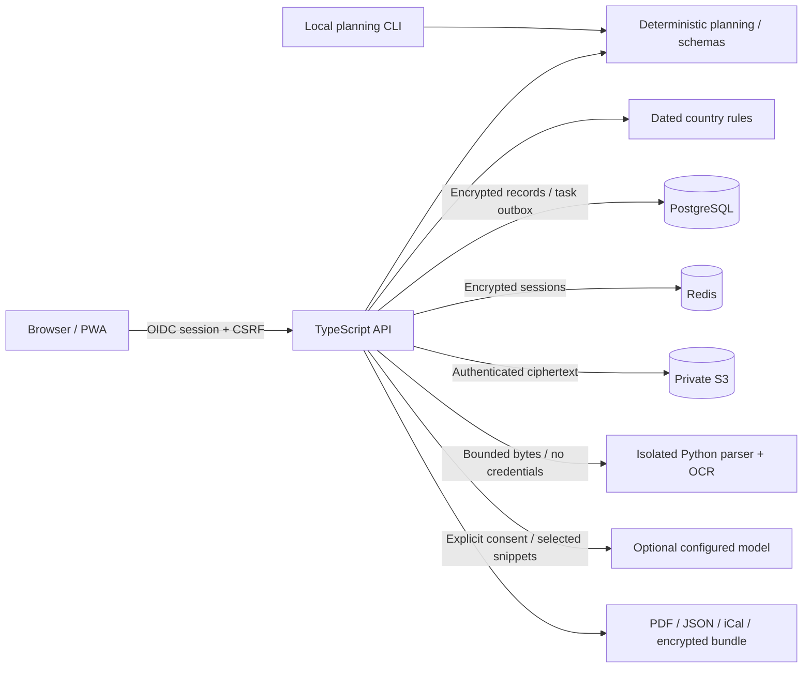

# Architecture

## Decisions

| Decision                     | Reason and consequence                                                                                                                               |
| ---------------------------- | ---------------------------------------------------------------------------------------------------------------------------------------------------- |
| Modular monolith, one API    | Lower operational cost and fewer distributed failure modes. Isolated document parsing is a separate process/service.                                 |
| Public JSON Schema           | Portable trip data, explicit unknowns, generated TypeScript and contract validation before persistence.                                              |
| Deterministic core           | Money, dates, permissions, rule applicability and allocation never depend on an LLM.                                                                 |
| Encrypted records and blobs  | PostgreSQL/S3 do not receive plaintext payloads. Indexed metadata is minimized; encryption does not hide record counts, sizes or access patterns.    |
| Workspace transaction        | PostgreSQL advisory transaction lock and CAS version checks serialize edits and erasure. Demo memory store implements equivalent workspace rollback. |
| Durable tasks in PostgreSQL  | Queue/recovery status and erasure outbox survive restart. Redis handles sessions and one-time state, not the only copy of evidence or jobs.          |
| No automatic provider lookup | v0.1 accepts supplied documentary evidence and authenticated webhooks. No fabricated inventory or unauthorized scraping.                             |
| Installable web app          | One responsive pt-BR/en interface; offline static shell plus explicitly exported encrypted bundles. Native mobile is deferred.                       |

## Modules

`schema/`: canonical closed contracts and generated types. `api/`: authentication,
records, evidence lifecycle, assessment, planning, exports and moderation.
`web/`: responsive app, offline verifier and static-only service worker. `mobile/`:
PWA installation contract. `ingest/`: bounded extraction subprocesses and HTTP
worker. `rules/`: dated country facts. `prompts/`: portable commands. `docs/`:
operator/contributor contracts.

## Evidence lifecycle

1. Authorize workspace and admit a bounded upload; never trust its filename.
2. Hash original bytes; encrypt and store them under an opaque identifier.
3. Persist quarantined metadata and a queued extraction job atomically.
4. Parse with byte/page/pixel/time limits. A document cannot choose a tool, URL,
   role, workspace, model configuration or output schema.
5. Store literal proposals with source spans as `extracted`, requiring review.
6. A separate authenticated action applies selected fields to a versioned trip.
7. On expiry/deletion, redact source-owned derivatives and affected revisions,
   unlink reviews/events and queue durable ciphertext deletion. Unrelated
   user-entered values and history are preserved.

`confirmed` means a supplied confirmation recorded by a user, not cryptographic
proof from a supplier. Attaching a document never upgrades it to authentic.

## Economics and extensibility

No default orchestration loops, embeddings, vector database or multi-agent swarm.
Deduplicate originals by workspace/trip/hash; extract literal text first; use OCR
only where text is insufficient. Optional LLM extraction receives at most six
bounded policy snippets, makes at most two calls, reserves a conservative budget,
and reuses a durable result. Provider prices are not invented: dollar cost is
unknown unless an operator supplies independently maintained accounting.

Use contract/latency/cost measurements before extracting more services. The
current in-process admission limits are per API instance; fleet-wide quotas,
fair scheduling and capacity planning are required before horizontal scaling.
