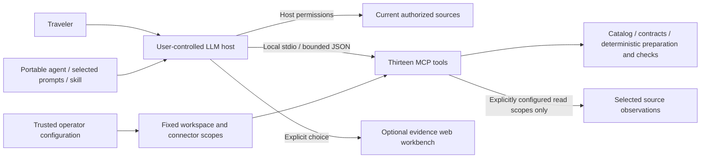
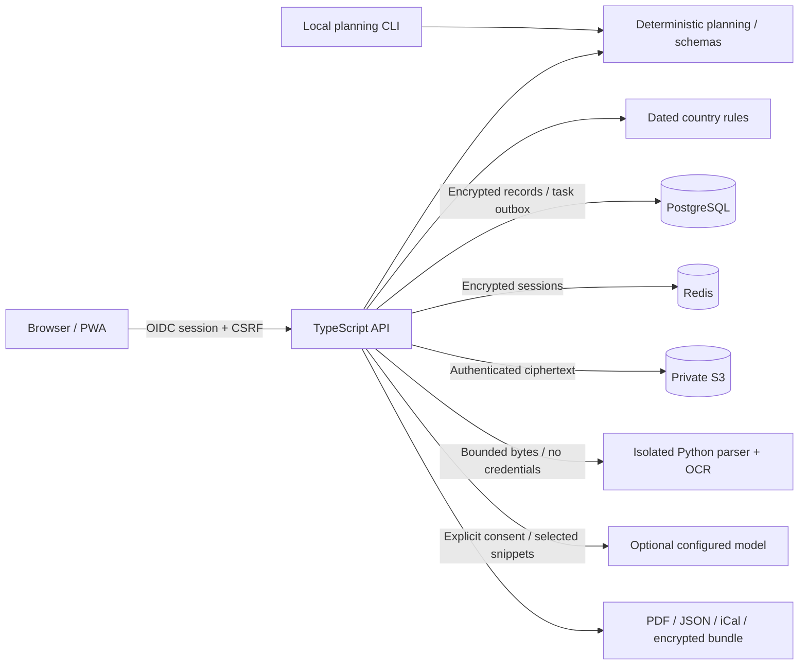

# Architecture

Version 0.4 separates the portable catalog from executable capabilities. `agents/manifest.json`, format 3, declares eleven roles and 66 commands with explicit domain, phase, owner, minimum inputs and optional executor. `agent/catalog.ts` validates it; MCP and release packaging consume the same registry. `agents/coverage.json` contains opaque provenance identifiers and functional coverage without private filenames, source hashes, case details or source text. The nine planning calculators retain their IDs and API/UI contracts; known-expense settlement is a separate read-only executor. Original work adopts MIT from v0.4.0; historical releases and third-party materials retain their own terms.

MCP adds compact catalog discovery and stateless workflow preparation. Checkpoints retain only pseudonymous IDs, declared field/source references, deadlines and counters; they are neither verified facts nor reusable permissions. Host research, external effects, scheduling and accumulated resource enforcement remain the host's responsibility. Instructions are selected on demand rather than concatenating all roles and prompts.

## Agent first

The primary user experience is an agent attached to the traveler's own LLM host. The portable agent and nine selected commands require no application installation. A self-contained skill ZIP supports hosts that discover `SKILL.md`; other hosts use the same instructions manually. Host tools supply authorized browsing, current supplier information and private evidence storage. None of those capabilities are invented by a prompt.

The optional MCP stdio runtime announces thirteen bounded tools and 78 fixed resources/prompts, including compatibility aliases. The original calculator, schema, brief and contract-check tools coexist with catalog discovery, workflow preparation, expense settlement, global context, booking reconciliation, operator-scoped source reads, workspace inventory/planning and extension drafts. The default entrypoint is offline and makes no model/provider/network calls. Optional account reads require an operator-configured registry; the Gmail profile reads only explicitly bound messages. No tool accepts credentials, modules or an arbitrary private root, or performs booking, payment or messaging. The host retains its permissions and user consent boundary.

The web workbench below is an optional evidence and operations layer. Its separately configured model-assisted extraction is optional and does not replace the user's LLM host. Research claims, prices and confirmations still require fresh evidence and appropriate authorization.

## Decisions

| Decision                     | Reason and consequence                                                                                                                                                                                                  |
| ---------------------------- | ----------------------------------------------------------------------------------------------------------------------------------------------------------------------------------------------------------------------- |
| Modular monolith, one API    | Lower operational cost and fewer distributed failure modes. Isolated document parsing is a separate process/service.                                                                                                    |
| Public JSON Schema           | Portable trip data, explicit unknowns, generated TypeScript and contract validation before persistence.                                                                                                                 |
| Deterministic core           | Money, dates, permissions, rule applicability and allocation never depend on an LLM.                                                                                                                                    |
| Encrypted records and blobs  | PostgreSQL/S3 do not receive plaintext payloads. Indexed metadata is minimized; encryption does not hide record counts, sizes or access patterns.                                                                       |
| Workspace transaction        | PostgreSQL advisory transaction lock and CAS version checks serialize edits and erasure. Demo memory store implements equivalent workspace rollback.                                                                    |
| Durable tasks in PostgreSQL  | Queue/recovery status and erasure outbox survive restart. Redis handles sessions and one-time state, not the only copy of evidence or jobs.                                                                             |
| Explicit provider boundaries | Documentary inputs and signed webhooks remain supported. Optional connector reads are operator-compiled/scoped; Gmail does not search the entire inbox, and no universal airline, lodging or live-fare API is inferred. |
| Installable web app          | One responsive pt-BR/en interface; offline static shell plus explicitly exported encrypted bundles. Native mobile is deferred.                                                                                          |

## Modules

`agents/` and `prompts/`: portable agent/workflows. `skills/`: skill entrypoint whose references are assembled from canonical files. `agent/`: bounded MCP/catalog/brief runtime, global context, connector registry, booking reconciliation, document workspace, operator profile and extension drafts. `security/`: reproducible SAST/DAST/fuzzing support. `schema/`: canonical closed contracts and generated types. `api/`: authentication,
records, evidence lifecycle, assessment, planning, exports and moderation.
`web/`: responsive app, offline verifier and static-only service worker. `mobile/`:
PWA installation contract. `ingest/`: bounded extraction subprocesses and HTTP
worker. `rules/`: dated country facts. `prompts/`: portable commands. `docs/`:
operator/contributor contracts.

## International context and operator capabilities

Language tags use BCP 47 validation. Requested language, formatting locale,
currency, time zone and jurisdiction are separate fields; deterministic message
templates currently use pt-BR/en and expose their actual fallback. Global
context covers international, domestic, subdivision, intermunicipal and local
travel, multiple purposes, DST ambiguity and multimodal dependencies. Supplied
location codes are not geocoding or assigned-code verification. Country source
plugins discover selected official portals; they do not imply executable foreign
rights, entry eligibility, current exchange rates or authenticated reservations.

The [operator profile](OPERATOR_PROFILE.md) is startup configuration, never an
LLM tool argument. It binds a local document root and optional Gmail trip/record
selectors. Secrets come only from the process environment. MIME normalization
uses an absolute, preprepared Python interpreter, isolated flags, a fixed reviewed
module and bounded pipes; it does not resolve an interpreter from the working
directory, invoke an installer or pass raw mail/secrets through arguments/logs.
Adapters are trusted operator code, not a JavaScript sandbox. Read budgets are
per process and do not measure every upstream request or host token cost.

The [document workspace](DOCUMENT_WORKSPACE.md) inventories metadata and prepares
plans. Copy/move preserves opaque PDF/image bytes; text control files use strict
bounded UTF-8. Actual writes and rollback remain in the operator CLI, with
specific plan digests, source rehashing, destination checks and journals. MCP has
no apply/rollback tool. Cooperative locking and filesystem checks do not provide
atomic multi-file transactions or isolation from another writer with the same OS
permissions. Partial writes without a journal require reconciliation.

[Extension generation](EXTENSIONS.md) produces complete reviewable files and
hashes without installation, execution or new permissions. [PDF export](UNICODE_EXPORTS.md)
preflights glyph coverage against the same font bytes it embeds. The operator
supplies a local licensed font; fonts are neither bundled nor downloaded. Missing
coverage fails explicitly, and complex-script layout still needs visual review.

## Evidence lifecycle

1. Authorize workspace and admit a bounded upload; never trust its filename.
2. Hash original bytes; encrypt and store them under an opaque identifier.
3. Persist quarantined metadata and a queued extraction job atomically.
4. Parse with byte/page/pixel/time limits. A document cannot choose a tool, URL,
   role, workspace, model configuration or output schema.
5. Store literal proposals with source spans as `extracted`, requiring review.
6. A separate authenticated action applies selected fields to a versioned trip.
7. On expiry/deletion, redact source-owned derivatives and affected revisions,
   unlink reviews/events and queue durable ciphertext deletion. Unrelated
   user-entered values and history are preserved.

`confirmed` means a supplied confirmation recorded by a user, not cryptographic
proof from a supplier. Attaching a document never upgrades it to authentic.

## Economics and extensibility

No default orchestration loops, embeddings, vector database or multi-agent swarm.
Deduplicate originals by workspace/trip/hash; extract literal text first; use OCR
only where text is insufficient. Optional LLM extraction receives at most six
bounded policy snippets, makes at most two calls, reserves a conservative budget,
and reuses a durable result. Provider prices are not invented: dollar cost is
unknown unless an operator supplies independently maintained accounting.

Use contract/latency/cost measurements before extracting more services. The
current in-process admission limits are per API instance; fleet-wide quotas,
fair scheduling and capacity planning are required before horizontal scaling.
